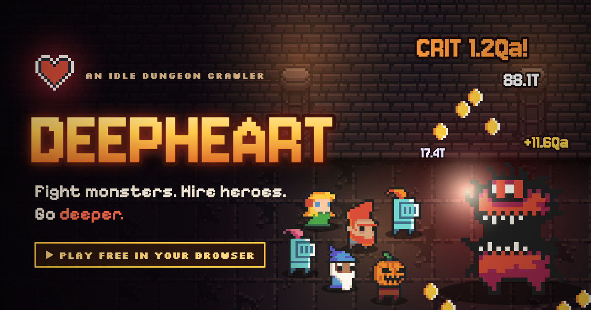
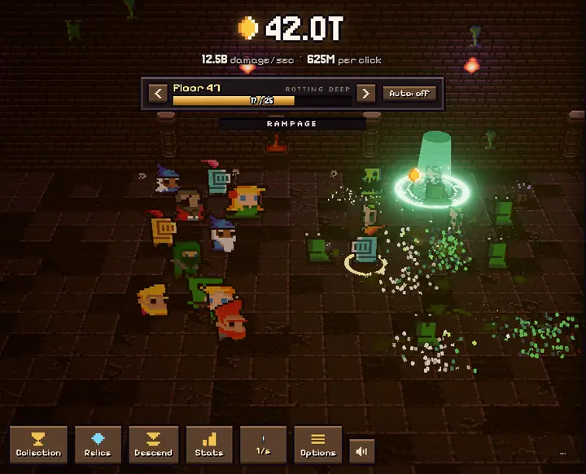

# Deepheart

[](https://jamesurobertson.github.io/deepheart/)
[](https://github.com/jamesurobertson/deepheart/releases/latest)

[](https://github.com/jamesurobertson/deepheart/actions/workflows/deploy.yml)
[](https://github.com/jamesurobertson/deepheart/actions/workflows/desktop.yml)



Fight monsters, hire companions with the gold they earn, and descend the dungeon for souls.
**Play it at https://jamesurobertson.github.io/deepheart/**, or
**[download the desktop app](https://github.com/jamesurobertson/deepheart/releases/latest)** for Mac, Windows or Linux.

## Every monster has a card



One card for every monster in the dungeon, and a gold copy of each. A monster drops its card about once in two
million kills, a boss once in 500,000, and a champion's gold card once in 250,000. Cards spin out of the monster
face-down and land face-up. Pick one up and it flips over in a burst of light, straight into your collection.
Complete a set for +25% damage, or +50% for a gold set. Send a hunter on an expedition to go after the cards you're
missing.

## What's down there

- **A party that fights for you.** Hire 32 companions with the gold they earn, level them into the thousands, and
  pick a hero to lead around the Keep with your mouse (or a finger).
- **Expeditions.** Send a strong companion to hunt a floor's cards while you play, or while you're away.
- **Ascend** for souls and summon Spirits; past floor 400, **awaken the Heart** for bound souls and the eight Bound.
  Two prestige layers, and every run back down is faster than the last.
- **The Keep**, the castle above the dungeon: walk your hero between the Spirits' shrine, the Heart, the traders and
  Koko the cat.
- **Treasure goblins** that run for the exit with your loot. Every so often one is a rainbow. Catch it and find out.
- **No bottom.** The eight zones come back corrupted, then abyssal, hollow, eternal, and the numbers keep climbing
  past 1e308.
- **117 trophies** and 30 cursors to unlock.

## Getting Started

1. Clone the repository
2. Install dependencies with `npm install`
3. Run the development server with `npm run dev`

Add `?slot=name` to the URL to keep a separate save. On the dev server only: `?speed=10` runs the game faster,
`?sim=300` starts from where a nonstop player first reaches floor 300 (in its own slot), and `?cards=often` makes
cards drop hundreds of times as often (and champion bosses common).

## Development

The project is built with:

- three.js
- TypeScript
- Vite
- break_infinity.js (gold, damage and costs go far past 1e308)

`node scripts/balance.ts 8 5 30 0.3` runs a headless pacing sim (hours, clicks/sec, active minutes, descend ratio).
`npm run timeline` plays a casual player (three 20-minute sessions a day, offline in between, ascending once stuck) for 300 played hours and checks the long-term timeline: first wall, first ascent, the companions met by then, every regular companion met, each late companion in its window, first awakening, and never too long without something new, plus the first run's floor times and hourly depth for the first 10 hours. It takes about a minute. [docs/scaling-analysis.md](docs/scaling-analysis.md) has the current numbers.
`node scripts/build-atlas.ts` repacks the sprite atlas after adding art.
`node scripts/card-sound.ts` regenerates the card drop and vault chest sounds.

## Desktop app

`desktop/` wraps the built game in Electron. `cd desktop && npm install`, then `npm start` to run it or
`npm run dist:mac` (or `dist:win`, `dist:linux`) to package it into `desktop/release/`.
Pushing a version tag (`git tag v0.2.0 && git push origin v0.2.0`) builds all three on GitHub and publishes them as a
release (`.github/workflows/desktop.yml`).

## Building for Production

To build the project for production:

```bash
npm run build
```

The built files will be in the `dist` directory.

## Deploying

Every push to `main` builds the game and publishes it to GitHub Pages at
https://jamesurobertson.github.io/deepheart/ (`.github/workflows/deploy.yml`).

## Credits

All CC0. Art: [0x72 DungeonTileset II](https://0x72.itch.io/dungeontileset-ii) and its Sewers add-on,
[Enchanted Forest Characters](https://superdark.itch.io/enchanted-forest-characters), [Fantasy RPG Characters](https://superdark.itch.io/16x16-free-npc-pack) and
[Samurai Fantasy Characters](https://superdark.itch.io/16-x-16-samurai-fantasy-characters) by Superdark,
[Homage to 0x72](https://rancidmilk.itch.io/0x72-homage) by RancidMilk,
[jungle & desert tiles](https://omniboy.itch.io/custom-dungeon-16x16-tileset) by Omniboy,
[Dark Dungeon](https://kosinaz.itch.io/16x16-dark-dungeon-tileset) by Zoltan Kosina,
[DungeonTileset II Extended](https://nijikokun.itch.io/dungeontileset-ii-extended) by Niji,
[CR+ TileSet](https://anritool.itch.io/cr-tileset) characters by AnriTool,
[Pixel Art Spells](https://opengameart.org/content/pixel-art-spells) by DevWizard.
Sound: [Kenney](https://kenney.nl) sound packs. Music: Juhani Junkala's
[Chiptune Adventures](https://opengameart.org/content/4-chiptunes-adventure) and
[5 Chiptunes (Action)](https://opengameart.org/node/55580), [Spooky Dungeon](https://opengameart.org/content/spooky-dungeon) by Memoraphile,
[Desert Theme](https://opengameart.org/node/124080) by Ted Kerr (Wolfgang_), [Void Estate](https://opengameart.org/content/haunting-chiptune-loop-void-estate) by Zane Little,
[Dark Forest Waltz](https://opengameart.org/content/10-track-modern-chiptune-demo) by The Art Bros, [Fields of Ice](https://opengameart.org/content/fields-of-ice) by Jonathan So and [The Bard's Tale](https://opengameart.org/content/chiptune-medieval-the-bards-tale) by RandomMind (the Keep). The Rainbow Vault theme is generated by `scripts/vault-music.ts`.
